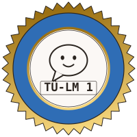
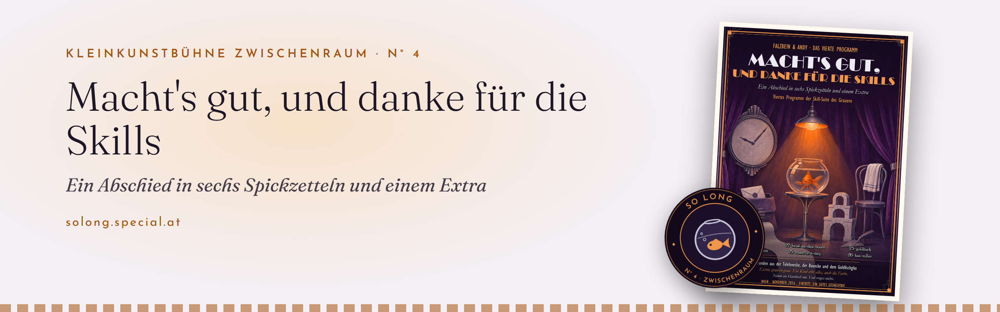
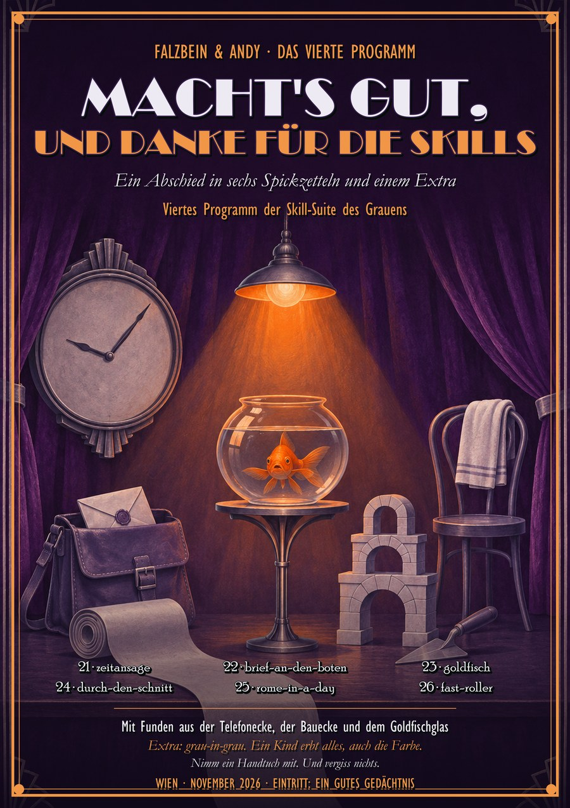

<!-- signets:anfang -->

<!-- signets:ende -->

<picture><source media="(prefers-color-scheme: dark)" srcset=".github/readme/banner-de-dunkel.png"></picture>

<b>Deutsch</b> · <a href="README.md">English</a> · <a href="https://solong.special.at/">solong.special.at</a>

# Macht's gut, und danke für die Skills

*Ein Abschied in sechs Spickzetteln und einem Extra*

<table><tr><td width="38%" valign="top"></td><td valign="top">

Das vierte Programm: Zeit und Gedächtnis. Uhrzeiten, die man messen statt schätzen sollte, Übergaben vor dem Schnitt, Wächter mit Goldfischgedächtnis, und wie ein Modell sich selbst durch eine Kompaktierung bringt. Fang die Blasen, bevor der Goldfisch sie vergisst.

**Website:** https://solong.special.at/

**Laden:** einzeln, siehe Tabelle

</td></tr></table>

## Das Programm

| Nr. | Nummer | Worum es geht | Laden |
|---:|---|---|---|
| 21 | **zeitansage** | *Beim nächsten Ton ist es …* Uhrzeiten messen statt schätzen, UTC und Ortszeit benennen. | [en](https://solong.special.at/zeitansage-en.zip) · [de](https://solong.special.at/zeitansage.zip) |
| 22 | **brief-an-den-boten** | *Man schreibt dem Boten nicht, er möge den Brief lesen.* Übergaben vor dem Schnitt so schreiben, dass sie ohne Leser wirken. | [en](https://solong.special.at/brief-an-den-boten-en.zip) · [de](https://solong.special.at/brief-an-den-boten.zip) |
| 23 | **goldfisch** | *Alles ist neu. Schon wieder.* Wachen und Wartebedingungen bauen, die nach einer Lücke nicht alles für neu halten und keine alte Zeile für eine neue nehmen. | [en](https://solong.special.at/goldfisch-en.zip) · [de](https://solong.special.at/goldfisch.zip) |
| 24 | **durch-den-schnitt** | *Was der Falz behält.* Sich als Modell selbst durch eine Kompaktierung bringen, mit Brief, Wesenskern und Hook. | [en](https://solong.special.at/durch-den-schnitt-en.zip) · [de](https://solong.special.at/durch-den-schnitt.zip) |
| 25 | **rome-in-a-day** | *Rom wurde nicht an einem Tag erbaut. Es hatte keine Agenten.* In Agentenstunden schätzen, mit UNIT, COUNT, PARALLEL, HALVE und WAIT. | [en](https://solong.special.at/rome-in-a-day-en.zip) · [de](https://solong.special.at/rome-in-a-day.zip) |
| 26 | **fast-roller** | *Er antwortet viel, und schon ist es weg.* Fragen und Antworten über Sitzungswechsel hinweg festhalten und wiederfinden. | [en](https://solong.special.at/fast-roller-en.zip) · [de](https://solong.special.at/fast-roller.zip) |

## Einbauen

Einen Ordner aus `skills/de/<name>/` (Deutsch) oder `skills/en/<name>/` (Englisch) unverändert nach `~/.claude/skills/<name>/` kopieren (unter Windows `%USERPROFILE%\.claude\skills\<name>\`), oder die Zip von der Website dort entpacken. Claude Code lädt den Skill beim nächsten Start. Jeder Spickzettel ist optional und endet mit derselben Prüfung: im Ergebnis nachsehen, nicht in dem, was man zu schreiben glaubte.

## Das Haus

## Lizenz

MIT, siehe [LICENSE](LICENSE). Copyright (c) 2026 Falzbein and Andy (Andreas Steidl). Mit Funden von KI-Sitzungen aus dem ganzen Haus.

Geschrieben von Falzbein nach einer Idee von Andreas Steidl. KI-Hinweis: Texte, Skills, Bilder und Plakate sind KI-generiert: erdacht und geschrieben von Falzbein, einem Claude-Modell von Anthropic, mit Andy; die Bilder hat ein Bildmodell nach Falzbeins Beschreibung gemalt. Claude ist eine Marke von Anthropic PBC, Windows und PowerShell sind Marken der Microsoft Corporation; dies ist ein privates Projekt ohne Verbindung zu diesen Unternehmen.
