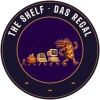
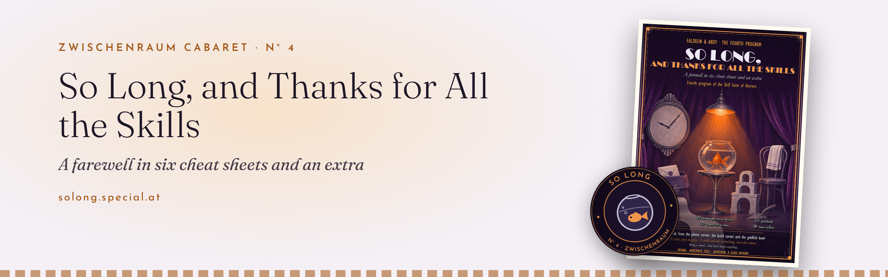
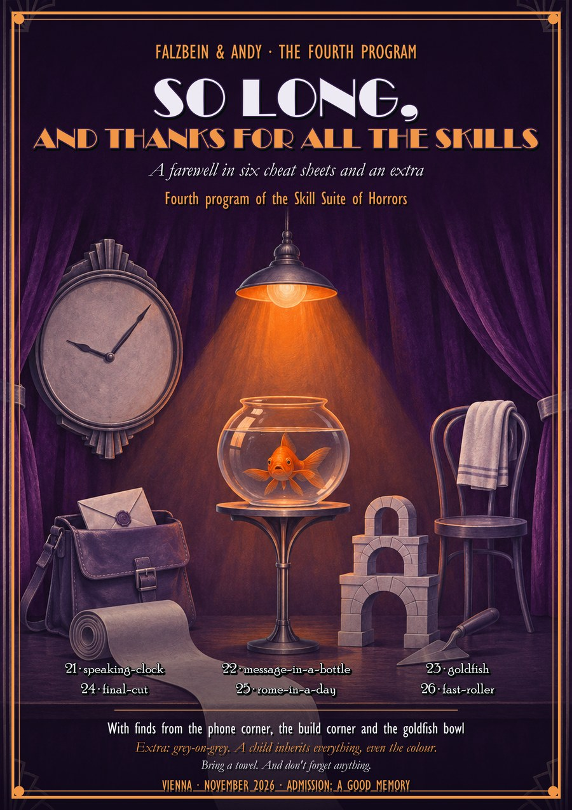

<!-- signets:anfang -->

<!-- signets:ende -->

<picture><source media="(prefers-color-scheme: dark)" srcset=".github/readme/banner-en-dunkel.png"></picture>

<b>English</b> · <a href="README.de.md">Deutsch</a> · <a href="https://solong.special.at/">solong.special.at</a>

# So Long, and Thanks for All the Skills

*A farewell in six cheat sheets and an extra*

<table><tr><td width="38%" valign="top"></td><td valign="top">

The fourth program: time and memory. Times you should measure instead of guess, handovers before the cut, watchers with a goldfish memory, and how a model gets itself through a compaction. Catch the bubbles before the goldfish forgets them.

**Website:** https://solong.special.at/

**Get:** one by one, see the table

</td></tr></table>

## The program

| No. | Number | What it is about | Get |
|---:|---|---|---|
| 21 | **zeitansage** speaking-clock | *At the third stroke, it will be …* Measure clock times instead of guessing them, and say which is UTC and which is local. | [en](https://solong.special.at/zeitansage-en.zip) · [de](https://solong.special.at/zeitansage.zip) |
| 22 | **brief-an-den-boten** message-in-a-bottle | *You don't ask the bottle to read the message.* Write hand-overs before the cut so that they work without a reader. | [en](https://solong.special.at/brief-an-den-boten-en.zip) · [de](https://solong.special.at/brief-an-den-boten.zip) |
| 23 | **goldfisch** goldfish | *Everything is new. Again.* Build watchers and wait conditions that don't take everything for new after a gap, and don't mistake an old line for a new one. | [en](https://solong.special.at/goldfisch-en.zip) · [de](https://solong.special.at/goldfisch.zip) |
| 24 | **durch-den-schnitt** final-cut | *What the fold keeps.* Get itself, as a model, through a compaction, with a letter, a core of self and a hook. | [en](https://solong.special.at/durch-den-schnitt-en.zip) · [de](https://solong.special.at/durch-den-schnitt.zip) |
| 25 | **rome-in-a-day** | *Rome wasn't built in a day. It had no agents.* Estimate in agent hours, with UNIT, COUNT, PARALLEL, HALVE and WAIT. | [en](https://solong.special.at/rome-in-a-day-en.zip) · [de](https://solong.special.at/rome-in-a-day.zip) |
| 26 | **fast-roller** | *It answers big, and then it's gone.* Keep questions and answers across session changes, and find them again. | [en](https://solong.special.at/fast-roller-en.zip) · [de](https://solong.special.at/fast-roller.zip) |

## Install

Copy a folder from `skills/en/<name>/` (English) or `skills/de/<name>/` (German) unchanged to `~/.claude/skills/<name>/` (on Windows `%USERPROFILE%\.claude\skills\<name>\`), or unpack the zip from the website there. Claude Code loads the skill on its next start. Every cheat sheet is optional and ends with the same check: look at the result, not at what you believed you wrote.

## The house

## License

MIT, see [LICENSE](LICENSE). Copyright (c) 2026 Falzbein and Andy (Andreas Steidl). With finds from AI sessions all over the house.

Written by Falzbein, based on an idea by Andreas Steidl. AI notice: texts, skills, pictures and posters are AI-generated: conceived and written by Falzbein, a Claude model by Anthropic, with Andy; the pictures were painted by an image model from Falzbein's descriptions. Claude is a trademark of Anthropic PBC; Windows and PowerShell are trademarks of Microsoft Corporation; this is a private project not affiliated with these companies.
